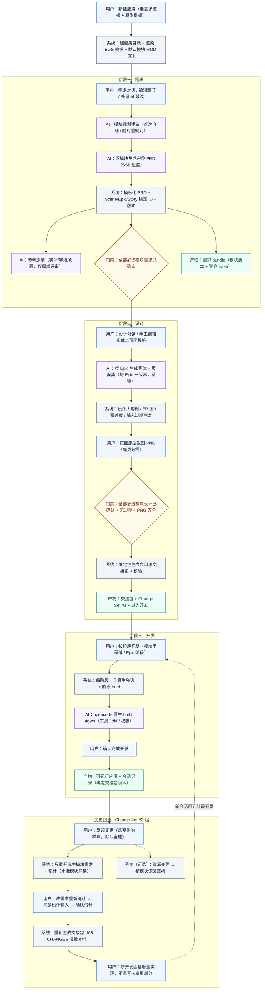

# AI Dev Workbench 业务说明（汇报 / 演示版）

> **文档用途**：同事汇报、领导演示。回答三个问题——它是什么、怎么走通一条业务链路、为什么可信。
> **版本**：2026-11-17（依据仓库当前实现与 `docs/STATUS.md`）。
> **口径**：文中所有能力、产物、门禁与数字均取自 `docs/STATUS.md` 及 `docs/plans/*` 设计稿与交接单；不包含任何真实应用业务数据、真实凭据或内部 ID。未验证项一律在「边界与未验证」中单列，不写成已支持。
> **配套文件**：`ai-dev-workbench-overview.html`（单文件离线演示版）、`ai-dev-workbench-overview.pdf`（A4）、`assets/flow-overview.svg`（可编辑流程图，可直接放 PPT）、`assets/flow-overview.png`（流程图位图）。

---

## 0. 一页摘要

**一句话定位**：AI Dev Workbench 是一个**三阶段 AI 开发工作台**——需求 → 设计 → 开发，前一阶段由用户确认后才进入下一阶段，设计完成时**确定性生成开发交接包**，开发阶段把交接包交给 **opencode 原生 agent** 完成实现；需求/设计变更走**变更单（Change Set）**，只重开受影响的模块。

### 0.1 它解决什么问题

| # | 现实痛点 | 工作台的做法 |
| --- | --- | --- |
| 1 | 需求散落在聊天、会议纪要和几个 Word 里，验收标准缺失 | 模板化 PRD（章节 + 必填校验），模块内 Scene / Epic / Story 结构化，AI 建议**先预览再应用**（章节勾选 + 行级 diff） |
| 2 | 大系统被压成一份 PRD，越写越糊 | **按业务域拆模块**：一个模块 = 一份完整 PRD + 一套设计（实体/页面集/原型/版本/确认） |
| 3 | 需求改了，设计还是旧的，交接时才发现 | 设计输入绑定需求**版本 + hash**，需求一变即「过期」，同步/重新确认有明确入口 |
| 4 | 交接靠人讲，开发反复回来问 | 设计确认后**确定性生成交接包**（需求/数据模型/页面/计划/变更/schema/manifest/原型图），开发只读文档即可开工 |
| 5 | 改需求像推倒重来 | 变更单**选择受影响模块**，未选模块版本、确认、输入逐行不动；`05-CHANGES.md` 给出增量 diff |
| 6 | 开发过程是黑盒，无法判断进度 | 原生 opencode 会话时间线：工具卡、diff、shell、权限/表单卡片、上下文健康度、会话归档与恢复 |

### 0.2 三类使用者（可一人多角色）

- **需求 / 产品**：对话澄清 → 审阅模板化 PRD → 规划模块 → 确认模块 → 完成需求阶段。
- **设计 / 架构**：设计大纲树里按 Epic 生成实体与页面集 → 调页面规格与原型截图 → 看覆盖度 → 逐模块确认设计。
- **开发**：按阶段领取交接包 → 在原生会话里实现 → 处理权限/表单询问 → 自测 → 交付确认。

### 0.3 关键卖点（汇报口径）

| 卖点 | 用户看到什么 | 为什么可信 |
| --- | --- | --- |
| 模板化 PRD | 章节树 + 必填提示 + 模板中心 | 模板/章节落库，版本可追溯；确认时服务端校验必填与 Story |
| 模块化 | 需求大纲与设计大纲都以模块为根 | 一模块一完整 PRD + 一套设计；模块独立版本、独立确认、独立变更范围 |
| 按 Epic 生成 | 「按 Epic 生成 / 生成此 Epic」+ 进度与重试 | 实体合并进模块共享池，不覆盖其它 Epic；每 Epic 一个设计版本、结果为草稿 |
| 确定性交接包 | 交接包弹窗：文件清单、模块表、规模、校验问题 | 不调模型；校验全部必选模块已确认、输入未过期、引用完整、每页 PNG 齐全 |
| 原生 opencode 开发 | 时间线 + 工具卡 + 权限/表单 + 上下文 chip | 用 opencode 原生 `build` agent 与原生会话；不做自定义 agent/批次/证据/Git 门禁 |
| 变更闭环 | 「发起变更」→ 模块勾选 → 重新确认 → 新交接包 → 新会话 | 未选模块只读；取消按模块恢复基线；`05-CHANGES` 只给增量 |
| 可追溯 | 版本弹窗带来源与变更单号；会话记录交接包版本/hash | 交接包版本 + SHA-256；需求 bundle 记录模块版本/hash |
| 演示可用 | 深浅色主题 + 1440/1280/1024/768 响应式 | 视觉 V1—V3 已完成全量截图回归（0 console error / 0 意外 API 错误 / 0 横向溢出） |

### 0.4 适用与不适用

- **适合**：中小型业务应用（EOS 后端 + Vue3 前端）、通常 1—6 个业务域、需求会反复调整、需要“评审 → 确认 → 交接 → 增量实现”可追溯链路、个人或小组快速交付。
- **本期不适合**：强合规与审批流、多租户/大团队并发协作（无登录与角色）、要求自动验收与交付证据链、与既有需求/项目管理平台双向同步。

### 0.5 当前状态（截至 2026-11-17）

- **功能**：D5（交接包）、C1（变更单）、R2a/b/c（版本 checkpoint）、I-10（会话列表）、I-09a（上下文健康度）、**M2—M6（模块化需求/设计/交接包/开发阶段）**、**RMP-1/RMP-2（AI 模块规划与重规划）**、**D-RMP（设计大纲树 + 按 Epic 生成）**、**M7/M7-2/M7-2b（需求阶段参考原型 + 解析容错）**、**U7（分阶段开发）**、视觉 V1—V3 均已实施并评审。
- **测试基线**：后端 **310** 个单元测试、前端 **167** 个单元测试（见 `AGENTS.md` 当前基线）。
- **真实模型全链路**（2026-11-16，临时应用，跑完已删除）：2 模块 / 17 Story / 7 实体 / 30 页面 / large 交接包 / 2 模块阶段 + 6 Epic 阶段 / 单模块变更 v2，**31/31 断言通过**，总耗时约 **191 秒**。
- **运行方式**：`start.cmd` / `stop.cmd`（Windows）或 `start.sh` / `stop.sh`（Linux）一键启停，默认 `http://localhost:3300`。

---

## 1. 业务流程图（核心）

### 1.1 读图方式

- **颜色 = 谁在做**：蓝色 = 用户动作；紫色 = AI 动作（调用模型）；灰色 = 系统动作（确定性代码）；琥珀色菱形 = 门禁；绿色 = 阶段产物。
- **实线 = 主流程**；虚线 = 变更回流的入口/出口（取消、回流）与说明性边界。
- **自上而下三段**：需求 → 设计 → 开发；**右侧一列是变更回流**（Change Set #2 起）。
- 图中不出现内部 ID 与英文实现名，便于对领导讲“业务怎么走”。

### 1.2 端到端主流程（Mermaid）

> 同一张图的**独立矢量源**见 `assets/flow-overview.svg`（自上而下三阶段 + 右侧变更回流，含图例、门禁菱形与阶段产物）。HTML 版内联了这张图，离线可用。

### 1.3 AI 与确定性怎么分工（领导最常问）

| 环节 | 谁做 | 说明 |
| --- | --- | --- |
| 需求对话、模块拆分建议 | AI（需求 agent + SSE） | 每轮注入当前模块模板与文档上下文；只输出文本/建议，不改文件 |
| 逐模块 PRD 生成 | AI（需求 agent） | 逐模块顺序生成（SSE 进度），失败可重试/取消；旧模块归档保留 |
| AI 参考原型 | AI（需求 agent） | 从 PRD 生成实体/字段/页面规格；**仅需求评审**，不写设计数据、不产 PNG、不进交接包 |
| 设计实体/页面集 | AI（设计 agent） | 按 Epic 生成，实体合并进模块共享池；每 Epic 一个版本，结果为草稿 |
| 开发实现 | AI（opencode 原生 build agent） | 原生会话/工具/权限，工作台只做 UI 与转发 |
| 阶段完成摘要 | AI（只读 agent） | 5—10 行中文摘要；失败回退到该阶段最后一条回复，阶段仍完成 |
| 模板渲染、章节/版本/hash | 系统 | 不调模型；版本来源可追溯（模板切换/AI 应用/确认/回滚/恢复/手动） |
| 门禁判定、只读控制 | 系统 | 阶段、确认、变更范围、归档状态共同决定可写性；不由模型判断“做完了” |
| 交接包渲染与校验 | 系统 | 确定性渲染 00—05/schema/manifest/模板/原型，校验失败不写盘、不切阶段 |
| 原型 PNG、阶段派生、05-CHANGES diff | 系统 | 纯代码；diff 只输出业务名称/表名/标题/稳定需求 ID |

---

## 2. 三个阶段

### 2.1 需求阶段

**目标**：把一个模糊想法收敛成**可确认、可交付**的需求——结构化、有验收、按业务域拆好模块。

**核心**：左侧 AI 对话 + 右侧模板化 Markdown 文档；模块是大纲树的根节点；Epics/Stories 是模块内拆分。

**关键工作逻辑**

1. 新建应用时选**需求模板**与**原型模板**（原型模板供设计阶段与需求阶段粗略预览使用）。需求阶段可选：**标准 PRD（13 节）**、**精简 PRD（6 节）**；**业务策略**同属需求阶段可选模板，但不直接进入设计（需要开发时改选标准 PRD）；**QA / 测试计划属测试阶段，需求阶段不可选**（新建应用的需求模板下拉只列需求阶段模板）。
2. 第一段实质需求进去，AI 先给**模块拆分建议**（模块名/说明/范围/建议 Epics/依赖与覆盖），用户在建议卡上改名、增删、调顺序后选择「应用拆分并生成」或「保持单模块」。
3. 逐模块生成完整 PRD（每个模块都覆盖模板全部章节；必需章节不可空；不适用写“不适用/不涉及”并说明）。
4. 需要调整结构时，用「AI 规划模块」随时重新拆分：保留 / 改名 / 重新生成 / 新建 / 归档，先看 diff 再应用；未匹配的旧模块默认归档（内容、版本、对话都保留，可恢复）。
5. 章节自动保存**不产版本**；手动保存、模板切换、AI 应用、确认、回滚、取消恢复才产版本（来源标签可查）。
6. AI 建议**先预览**：不写库、不产版本 → 章节勾选 + 行级 diff → 应用选中 / 忽略。
7. 每个模块单独「确认需求」：必填章节非空 + 至少 1 个 Epic/Story；确认后该模块只读。
8. 全部必选模块确认后，在「需求总览」点「**完成需求阶段**」——生成需求聚合 bundle（模块版本 + hash）并进入设计。
9. 可选：在需求大纲每模块末尾打开「原型预览」，显式生成 **AI 参考原型**，看字段和页面是否够用（用于需求评审，不进入设计与交接包）。
10. 需要改已确认模块时用「重新编辑需求」；进入设计/开发后改需求走变更单。

**输入**：用户描述、所选需求模板、已有章节/Epics/Stories、对话历史（按模块独立）。
**输出/产物**：逐模块完整 PRD（章节 + 结构化 Scene/Epic/Story + 版本）、需求 bundle 快照、可选的 AI 参考原型（仅预览）。
**门禁**：模块级确认 → 应用级「完成需求阶段」（bundle confirm）。
**常见操作**：新建/编辑/排序/归档模块、切换模板（应用级，逐模块预览影响）、问 AI、版本回滚、导出当前模块 PRD（`.md`）。

### 2.2 设计阶段

**目标**：把已确认的需求变成**可实现的设计**——实体与关系、页面集与页面规格、页面原型、需求覆盖度。

**核心**：左侧设计对话 + 中部设计大纲树（模块根 / 数据集 / Epic / 页面集 / 未归属）+ 右侧实体、原型、覆盖度三个 Tab。

**关键工作逻辑**

1. 模块与需求阶段一一对应；每个模块有自己的设计项目、版本与确认状态。
2. 设计大纲树里点模块 = 切换设计项目（切换前先落盘，避免丢输入）；点 Epic = 收窄实体/页面集视图并聚焦对话。
3. **按 Epic 生成**（可批量勾选或单 Epic「生成此 Epic」）：一次生成该 Epic 需要的实体与一个页面集；实体**合并进模块共享实体池**，不删其它 Epic 的实体/字段/关系；页面集替换该 Epic 的主页面集（保留页面集 ID），页面按 Story 组织。
4. 每个 Epic 生成一个**设计版本**，结果为**草稿**，不自动确认；批量生成有进度、失败重试、停止剩余。
5. 目标里含已确认的实体/页面集时，必须显式勾选「允许重新打开已确认项」，只有受影响项退回草稿，其它已确认项不动。
6. 页面必须有**原型截图 PNG**（每页必需）才能生成交接包；这是硬校验，不是提示。
7. 「覆盖度」按模块展示 Story 是否落到页面（未覆盖只提示、不阻塞）；「设计总览」汇总各模块的确认、缺图、过期状态。
8. 需求文档变更 → 该模块设计输入标记**过期**，需在同步弹窗里同步（可重新绑定输入并标记受影响项）后才能确认/生成。
9. 跨模块实体关系允许（只 warning，不阻塞）；页面集只能属于一个模块。
10. 每个模块单独「确认设计」；全部必选模块确认后，才在交接包弹窗生成应用级交接包。

**输入**：已确认需求文档 + 设计输入快照（版本/hash）、EPIC/STORY、应用级原型模板。
**输出/产物**：实体/关系/字段、ER 图、页面集与页面规格、页面原型与 PNG、覆盖度、逐模块设计版本。
**门禁**：模块级确认 → 全部必选模块 + 输入未过期 + 每页 PNG 齐全（交接包校验）。
**常见操作**：手工改实体/页面规格、截图存档、版本回滚、原型模板切换（应用级，任一模块已确认时需先重新编辑）、设计总览、交接包预览/生成。

### 2.3 开发阶段

**目标**：把交接包交给原生 AI agent，按阶段把应用真正做出来，并让进度与过程可见、可回看。

**核心**：交接包（文档契约）+ Change Set #1（初始开发基线）+ opencode 原生 `build` agent 会话。

**关键工作逻辑**

1. 交接包生成成功后应用进入开发，并创建 **Change Set #1**（首个包即“初始开发”基线）；开发会话记录该包的**版本 + hash**。
2. 大交接包（Story ≥10 / 页面 ≥12 / 文本 ≥100KB）会提示“建议分阶段”，可点「**按阶段开发**」按需生成阶段；普通包不生成阶段。
3. 阶段是**两层**：模块阶段（分组/里程碑，不建会话、不调摘要）→ 模块内 Epic 阶段（一个阶段一个原生会话 + 阶段 brief）。
4. 阶段 brief 写明目标、范围（Story/页面集/页面）、要读的交接包文件、上一阶段摘要，要求“只做本阶段范围”。
5. 会话内是原生体验：时间线（用户/assistant/思考/工具卡/diff/shell/错误）、权限与表单卡片内联、可停止、可追加消息。
6. 顶部「上下文」chip 按模型上下文窗口计算占用（60% 黄 / 85% 红），可一键「压缩上下文」（opencode 原生 compact），时间线出现压缩提示。
7. 会话列表按变更单分组：切换、重命名、备注、归档（只读）、恢复；切换/归档前先尽力中断当前运行。
8. 阶段「完成」只改阶段状态、不归档会话，并尽力生成阶段摘要（失败回退到最后一条回复）；「跳过」「重新打开」都在，向已完成阶段发消息会自动回到进行中。
9. 用户点「确认完成开发」记录完成；完成后在同一会话继续发消息，应用自动回到“开发中”（变更单保持已完成，纯开发修复不进变更单；若该会话属于已完成阶段，阶段自动回到进行中）。
10. 工作台**不做**自定义 dev agent/skill、固定骨架、批次、证据、Git 提交/推送、测试门禁、自动验收。

**输入**：交接包、Change Set、阶段（可选）、用户提示与权限/表单回复。
**输出/产物**：`projects/<app>/` 下的真实代码与配置、会话记录（含交接包版本/hash、阶段归属）、文件变化视图、阶段摘要。
**门禁**：无阶段门禁/无自动验收——是否完成由用户确认；生成交接包是进入开发的前置门禁。
**常见操作**：新建/切换/归档会话、按阶段开发、完成/跳过/重新打开阶段、压缩上下文、查看交接文档与 PNG、发起变更。

---

## 3. 阶段间交接逻辑（重点）

### 3.1 需求 → 设计

| 机制 | 具体行为 |
| --- | --- |
| 模块确认 | 每个模块独立确认（必填章节非空 + 至少 1 个 Epic/Story），确认后只读；其它模块可继续编辑 |
| 应用级完成 | 「完成需求阶段」要求**全部必选未归档模块**已确认；生成需求聚合 bundle 快照（模块版本 + hash + 聚合 hash），应用进入设计 |
| 设计输入 | 每个模块的设计项目绑定该模块需求**版本 + hash**（设计输入 v2 还记录 bundle 版本/hash） |
| 过期判定 | 需求文档变化 → 该模块设计输入 `stale`（按模块，不牵连其它模块）；应用级“bundle 漂移”只提示 |
| 重新同步 | 同步弹窗可选“重新绑定/仅预览/延后”，并标记受影响项；不清空历史版本 |
| 回退 | 已确认模块可用「重新编辑需求」退回草稿；进入设计后应用回需求阶段，设计暂时锁定，已生成设计/原型保留但标记过期 |

一句话：**需求不是“写完就算”，而是“确认成快照 + 设计绑定这个快照”**，所以“设计基于哪一版需求”永远说得清。

### 3.2 设计 → 开发

**交接包内容（写入 `projects/<app>/docs/handoff/`）**

| 文件 | 作用 |
| --- | --- |
| `00-README.md` | 版本/来源/范围/技术栈/阅读顺序/完成定义/关键约束；变更 #N 时提示先读 `05-CHANGES` |
| `01-REQUIREMENTS.md` | 按模块的完整已确认 PRD + 开放问题/术语 |
| `02-DATA-MODEL.md` | 按模块的实体/字段/关系/ER/约束/类型映射 |
| `03-PAGES.md` | 按模块的页面集/页面/每页字段与动作/状态/验收/PNG 路径/导航 |
| `04-PLAN.md` | 实施顺序、按模块的 Epic 与页面集清单、Story→页面验收、风险、交付格式；大包附带“建议分阶段”（可选、不门禁） |
| `05-CHANGES.md` | 初始开发=无基线差异；变更 #N=按模块的真实 diff（未选模块标“未变更”） |
| `schema.sql` | 参考 DDL（无真实外键、无凭据） |
| `prototype-template.json` | 原型模板 Token/Shell/模式 + hash |
| `manifest.json` | 版本/hash/文件清单/模块与统计/规模 scale/阶段 phases/变更单信息 |
| `prototypes/<模块>/<页面集>/page-*.png` | 每页原型截图（视觉参考，也是硬校验项） |

**生成前的校验（不过就 400 + 具体问题，不写盘、不切阶段）**

- 全部**必选**未归档模块的需求已确认、设计已确认；
- 每个模块的设计输入已绑定且**未过期**（stale 阻塞）；
- readiness/引用完整：`requirementRefs`、`epicId`、`storyIds` 必须存在；页面绑定的实体必须存在；
- **每一页都有原型 PNG**（文件存在且是 PNG）；
- 跨模块实体关系、跨模块表名重复、模板不一致 → 只 warning，不阻塞。

**生成时发生什么**

1. 预览（preview）只渲染、不写盘、不建变更单；
2. 生成（generate）写盘 + 版本递增 + 整体/单文件 SHA-256 + 记录 `design_handoffs`；
3. 首次生成创建 **Change Set #1**（初始开发）并写入全部未归档模块的基线行；应用状态 → 开发；
4. 开发会话记录交接包**版本 + hash + 变更单**，开发页显示「交接包 vN · 初始开发」；
5. 开发阶段且变更单仍在进行中时可重新生成：版本递增、复用同一变更单，并提示“应用目录可能已有代码，请增量修改”；变更单已完成或应用已完成后需先「发起变更」，否则生成返回 409。

> 说明：磁盘只保留**最新版本**的交接包文件；历史版本保留**元数据/hash/manifest**，但**不再提供文件内容与图片 URL**（避免指向当前版本的文件）；需要历史内容时重新生成。

### 3.3 开发 → 变更（Change Set #2 起）

| 环节 | 行为 |
| --- | --- |
| 发起 | 应用头部「发起变更」：选受影响模块（默认全选）+ 范围（需求+设计 / 仅设计）；「仅设计」之后可升级为「需求+设计」 |
| 重开范围 | **只**把选中模块的需求与设计退回草稿并重开确认；未选模块的需求/设计版本、确认状态、设计输入逐行不动 |
| 只读 | 未选模块在需求/设计页整块只读（写操作 409）；部分模块变更时，应用级模板切换被禁用（改为模块级） |
| 基线 | 变更单按模块记录需求/设计 baseline 版本与 hash；取消时按模块恢复 |
| 做变更 | 改需求 → 逐模块重新确认 → 同步设计输入（解除过期）→ 逐模块确认设计 |
| 重新生成 | 生成交接包 v(N+1)：`05-CHANGES` 按模块给真实 diff（实体/字段/关系/页面集/页面/Story 变更），未选模块写“未变更”，新模块写“新增模块” |
| 新会话 | 建议新建开发会话做增量实现；旧会话保留在列表（按变更单分组）可回看 |
| 取消 | 只能在新交接包生成前取消；按模块恢复需求/设计/模板/设计输入，并在同一事务重生成需求 bundle；**变更中新增的模块自动归档**（内容/版本保留，可恢复） |
| 禁止项 | 变更中不能归档模块；未选模块的任何写操作都返回 409（只读） |

一句话：**变更不是“改一个字段全链路重来”**，而是“选模块 → 重开这一块 → 增量 diff → 增量实现”。

### 3.4 两层开发阶段：模块阶段 vs Epic 阶段

| 维度 | 模块阶段（module） | Epic 阶段（epic） |
| --- | --- | --- |
| 作用 | 分组 / 里程碑（展示该模块整体进度） | 实际执行单元 |
| 会话 | **不建会话** | 一个阶段一个原生会话 |
| 摘要 | 不单独调模型；聚合展示子阶段摘要/进度 | 完成时生成摘要（失败回退最后回复） |
| 操作 | 不可开始/完成/跳过/重新打开（409），只读展示 | 可开始/完成/跳过/重新打开；完成不归档 |
| 状态 | 由子阶段派生（全占未开始→未开始；有进度→进行中；全部完成/跳过且有完成→已完成） | 自身状态机 |

单模块应用保持原有平铺阶段（基础 + 每个 Epic），多模块应用才启用“模块 + Epic”两层，避免小项目被过度结构化。

---

## 4. 关键机制（为什么可信）

### 4.1 模板与章节

模板决定“问什么、写什么、确认什么”。内置 4 个模板：**标准 PRD（13 节）**、**精简 PRD（6 节）**、**业务策略**（需求阶段可选，但不直接进入设计）、**QA / 测试计划**（测试阶段，需求阶段不可选）；另有 **2 个原型模板**。应用创建时选择需求模板与原型模板，之后可在需求/设计阶段切换（应用级切换有逐模块影响预览与二次确认）。模板只存 id/hash，不把模板正文复制进版本历史。

### 4.2 模块化：一个模块 = 一份完整 PRD + 一套设计

- 模块是**业务域/协作边界**，不按 CRUD、不按单实体拆。AI 规划建议通常 **1—6** 个模块：建议 **>8** 个时给 warning（逐模块生成耗时长），**>50** 个直接拒绝（`MAX_PLAN_MODULES=50`，仅约束 AI 规划/重规划）；**手工新增模块不设硬上限**。
- 模块有独立的需求文档、设计项目、版本、确认状态、变更范围、负责人标签。
- 模块新增只在需求阶段；设计/开发阶段必须走变更，避免“设计做着做着冒出新模块”。
- 归档代替删除：内容、版本、对话、设计数据都保留，可恢复。

### 4.3 版本 checkpoint 与回滚

- 自动保存**不产版本**，避免版本爆炸；模板切换、AI 应用、确认、回滚、取消恢复、手动保存才产版本，并带**来源标签**。
- 需求版本与设计版本都按模块独立；交接包有独立版本 + hash。
- 版本弹窗可看版本号、来源、变更单号与保存时间，可回滚；回滚本身也产版本（可再回退）。

### 4.4 确认与只读

- 已确认的模块文档/设计只读；要改先「重新编辑需求 / 设计」。
- 归档模块只读（可恢复）；变更范围外模块只读；历史会话与历史交接包只读。
- 只读是**状态机**语义，不是权限系统：本期没有登录/角色，接口层面的“谁能看”尚未实现。

### 4.5 变更单与追溯

- 每次变更是一个 Change Set（#1 初始开发，#2 起为真实变更），记录范围、模块基线、状态、生成/完成时间。
- `05-CHANGES.md` + `manifest.changeSet` 让开发 agent 明确“这次只改什么”；变更历史面板能看每个模块的范围与版本区间。
- 交接包、开发会话、阶段都绑定变更单与交接包版本，回溯时能对齐“哪版需求/设计 → 哪版交接包 → 哪个会话”。

### 4.6 交接包确定性 + 规模识别

- 交接包完全由结构化数据渲染，**不在导出时调用模型**，所以同一份数据多次生成内容一致（除版本/时间戳）。
- 文档不使用工作台内部 ID：实体/页面集/页面按模块顺序稳定编号（ENT-001 / PS-001 / PAGE-001），业务上可读、可引用。
- 规模识别：Story ≥10、页面 ≥12、文本 ≥100KB 命中即 `manifest.scale.suggested=true`，`04-PLAN` 插入“建议分阶段（可选）”，交接包弹窗与开发页显示规模与入口；**不强制、不门禁**。

### 4.7 开发阶段用原生 opencode（明确“不做什么”）

- 使用 opencode 原生 `build` agent 与原生会话、SSE、权限/表单、取消、compact。
- 工作台只提供：项目目录、会话 UI、权限/表单转发、上下文展示、完成确认。
- **不做**：自定义 dev agent/skill、固定骨架、批次/需求选择、交付证据、Git 强制流程、测试门禁、自动完成判定。这是“保留 agent 能力、只约束输入与确认点”的取舍。

### 4.8 AI 参考原型：只服务需求评审

- 由需求阶段 agent 从模块 PRD 生成“预览规格”（实体/字段/页面），前端用设计阶段同一套渲染器 + 示例数据渲染成真实字段的线框。
- **只写一个设置键**：不写需求/设计/交接包/变更单任何业务表，不产 PNG，不参与设计确认与覆盖度，设计阶段也不读它。
- 界面明确标注“AI 参考原型 · 仅用于需求评审”；需求改过会提示“建议重新生成”（不阻塞、不自动重生成）。
- 目的：在写代码前就发现“少字段、类型不对、页面缺动作、Story 没落到页面”。

### 4.9 失败重试与解析容错

- 模型输出用协议分隔符解析（`<<<DOC_JSON>>>` / `<<<MODULE_PLAN_JSON>>>` / `<<<DESIGN_JSON>>>` / `<<<PREVIEW_SPEC_JSON>>>`），协议互不复用。
- 原型规格解析做了容错（围栏/BOM/尾逗号/全角引号/字符串内裸换行/未闭合残片），失败**自动重试一次**；仍失败返回 502 并给可展开的“模型输出片段”（脱敏、截断），旧规格不被覆盖。
- 阶段摘要超时/失败回退到该阶段最后一条 assistant 文本，并给 warning，阶段仍算完成。
- 生成类操作（模块生成、按 Epic 生成、交接包）都是“成功才写库/写盘”，失败不留半成品。

---

## 5. 角色与使用方式

### 5.1 角色分工

| 角色 | 主要动作 | 关注点 | 交付给下一环的东西 |
| --- | --- | --- | --- |
| 需求 / 产品 | 对话、改章节、规划模块、确认模块、完成需求阶段 | 范围是否完整、验收是否可验证、模块边界是否合理 | 已确认需求 bundle（模块版本 + hash） |
| 设计 / 架构 | 按 Epic 生成、调实体与页面规格、截图、看覆盖度、确认设计 | 数据结构是否够用、页面是否覆盖 Story、原型是否符合预期 | 已确认设计 + 每页 PNG |
| 开发 | 领交接包、按阶段实现、处理权限/表单、自测、确认完成 | 增量范围、依赖与约束、上下文是否够用 | 可运行应用 + 会话记录 |
| 变更发起人（任一角色） | 发起变更、选模块、重走确认、生成新交接包 | 影响面、未选模块是否真的不受影响 | 新交接包 v(N+1) + 05-CHANGES |

### 5.2 三分钟演示脚本（投屏，讲主干）

| 步骤 | 操作 | 看什么 | 一句话 |
| --- | --- | --- | --- |
| 1 | 首页 → 新建应用，填名称，选需求模板 + 原型模板 | 两个模板下拉与说明 | “模板决定需求问什么、原型长什么样” |
| 2 | 进入需求页，左侧提问，右侧看章节 | 章节自动保存、AI 建议卡（章节勾选 + 行级 diff） | “AI 只给建议，落库要人点” |
| 3 | 需求大纲：看模块根、Epic、状态/版本 | 大纲树 + 需求总览 | “一个模块一份完整 PRD” |
| 4 | 切到设计页 | 设计大纲树（模块/数据集/Epic/页面集） | “设计按 Epic 生成，实体共享不重复” |
| 5 | 打开「按 Epic 生成」，跑一个 Epic | 进度、草稿标记、版本 +1 | “生成是草稿，确认是人做的” |
| 6 | 看原型与覆盖度 | 页面线框、PNG、Story 覆盖 | “每页 PNG 是交接包的硬条件” |
| 7 | 打开「交接包」弹窗 | 文件清单、模块表、规模/校验 | “交接包是确定性渲染，不靠模型写文档” |
| 8 | 进入开发页 | 阶段条、时间线、工具卡、上下文 chip | “开发用原生 agent，过程全可见” |
| 9 | 「发起变更」，只勾一个模块 | 模块多选、范围条、未选模块只读 | “改哪块重开哪块” |

### 5.3 十分钟演示脚本（加深度）

在 3 分钟版基础上补 4 段：

1. **模块规划**（需求阶段）：输入一段业务描述 → 建议卡出现 2 个模块 → 改名/调顺序 → 「应用拆分并生成」→ 看逐模块进度与两份文档。讲：不设固定模块数、不写库直到人确认。
2. **版本与确认**（需求阶段）：打开版本弹窗，指出“自动保存不产版本”，再指出确认/模板切换/AI 应用产版本且带来源；点「确认需求」看只读横幅与「重新编辑需求」入口。
3. **过期与同步**（设计阶段）：改需求后回设计页，看“需求已更新”提示与同步入口；讲“设计绑定需求版本+hash”。
4. **变更闭环**（开发阶段）：发起变更（只选一个模块）→ 改需求 → 确认 → 同步 → 确认设计 → 生成 v2 交接包 → 打开 `05-CHANGES.md` 看 diff（另一模块标“未变更”）→ 新会话增量实现。再演示「取消变更」恢复基线。

### 5.4 演示注意事项

- 真实模型有耗时与波动：需求单模块约 30—60 秒、设计实体/页面集约 15—35 秒（2026-11-16 实测），演示前先准备好数据或提前跑一遍。
- 需要“看起来有内容”的界面时，优先用已确认的模块/已生成的交接包；空态页信息量有限。
- 不要在演示中填写真实 DB/Nacos/邮件凭据：这些字段只用于渲染应用目录里的配置文件，且未填写即写 `CHANGE_ME`。

---

## 6. 边界与未验证（诚实版）

| 项 | 现状 | 影响 / 说明 |
| --- | --- | --- |
| EOS 运行态 | 模板离线 `mvn dependency:resolve` + `compile` 通过；**运行态未验证** | 真实构建/启动依赖内部 Maven 仓库、EOS 制品、团队 license、Nacos/MySQL/Redis |
| 工作台与数据库 | 工作台只读写 SQLite，**不连接、不启动 MySQL** | 应用自己的数据库由应用/团队环境负责；工作台不执行 DDL |
| 登录与权限 | **无登录/角色**；`owner_label` 只是标签 | 未验证 401/403；只读来自状态机，不是权限隔离 |
| 移动端 | 已验证 1440 / 1280 / 1024 / 768；**768 以下未验证** | 演示与评审请用桌面分辨率 |
| 真实模型 | 有波动（曾出现一次原型规格解析失败） | 已加自动重试 + 诊断片段；仍建议重要生成前先试跑 |
| 旧应用数据 | **不做旧应用数据兼容**（开发前期政策） | 大框架调整默认删除旧应用/重置，不写迁移；升级有应用数据的旧库会 fail-closed 提示 |
| 交接包历史文件 | 磁盘只保留**最新版本**的文件；历史版本保留元数据/hash/manifest | 历史版本不提供文件内容与图片 URL（避免指向当前版本）；需要历史内容时重新生成 |
| 页面截图时效 | 改页面规格不会自动重截图 | 交接包用的是最后一张人工/工具存档的 PNG |
| OpenAPI / 真实外键 | 交接包不生成 OpenAPI，`schema.sql` 不含真实外键 | 缺少确定性 HTTP 契约与库级约束，交给开发判断 |
| 审批流 / Word 导出 / Git 门禁 | **没有** | 本期定位是“个人/小组 vibe coding 工作台”，不是流程平台 |

---

## 7. 术语表

| 术语 | 含义 |
| --- | --- |
| **模块（Module）** | 业务域/协作边界；拥有一份完整 PRD、一套设计、独立版本与确认状态 |
| **Scene / Epic / Story** | 模块内的场景 / 史诗 / 用户故事；稳定全局 ID（EPIC-001、STORY-001） |
| **模板与章节** | 需求模板定义章节结构与必填规则；原型模板定义页面模式与视觉 Token |
| **checkpoint（版本）** | 一次有来源的文档/设计快照；自动保存不产版本 |
| **bundle（需求聚合）** | 应用下全部模块需求文档的聚合快照：模块版本/hash + 聚合 hash |
| **设计输入（DesignInput）** | 设计项目绑定的需求快照（模块版本 + docHash + bundle 版本/hash） |
| **stale（过期）** | 需求变了但设计输入未同步；按模块判定，会阻塞设计确认与交接包 |
| **交接包（Handoff）** | 设计确认后确定性生成的开发材料（00—05 + schema + 模板 + manifest + 原型 PNG） |
| **Change Set（变更单）** | 一次需求/设计变更的范围与基线记录；#1 为初始开发，#2 起为真实变更 |
| **U7 阶段** | 开发阶段的两层结构：模块阶段（里程碑）+ Epic 阶段（会话） |
| **phase brief** | 开始阶段时给 agent 的首条提示：目标/范围/交接包入口/上一阶段摘要 |
| **上下文健康度** | 按模型上下文窗口算占用率（60% 黄 / 85% 红），可触发原生压缩 |
| **确定性渲染** | 不调模型，由结构化数据直接生成文档/清单/校验结果 |
| **必选模块** | 必须确认后才能进入下一阶段的模块；当前所有未归档模块默认必选 |

---

## 附录：本文依据

- `AGENTS.md`、`README.md`、`docs/STATUS.md`（M2—M6、RMP-1/RMP-2、D-RMP、M7/M7-2/M7-2b、U7、D5/C1、视觉 V1—V3 段落）
- `docs/plans/2026-11-09-workbench-v2-design.md`（总体方向：需求/设计 A、开发 B）
- `docs/plans/2026-11-13-module-requirements-design.md`（模块化需求 + 设计、门禁、交接包）
- `docs/plans/2026-11-16-requirements-module-planning-design.md`（RMP-1/RMP-2）
- `docs/plans/2026-11-16-design-stage-module-epic-alignment-design.md`（设计大纲树 + 按 Epic 生成）
- `docs/plans/2026-11-17-m7-2-ai-prototype-spec-design.md`（AI 参考原型的边界）
- `docs/plans/2026-11-12-u7-phased-development-design.md`（两层开发阶段）
- `templates/eos-app/README.md`（应用工程模板与外部前提）

> 与实现不一致而**主动省略**的内容：不写“导出 Word/PDF 需求文档”“审批流”“多人协同/权限矩阵”“Git 提交与证据门禁”“自动验收通过率”“多租户/容器调度”——这些在当前实现中不存在或未验证。
