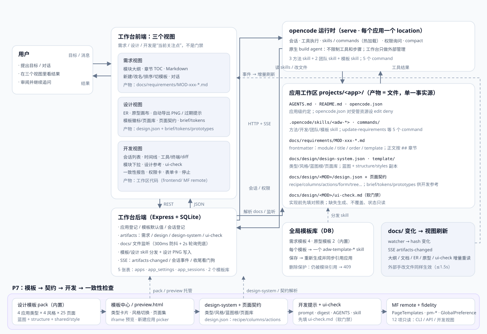
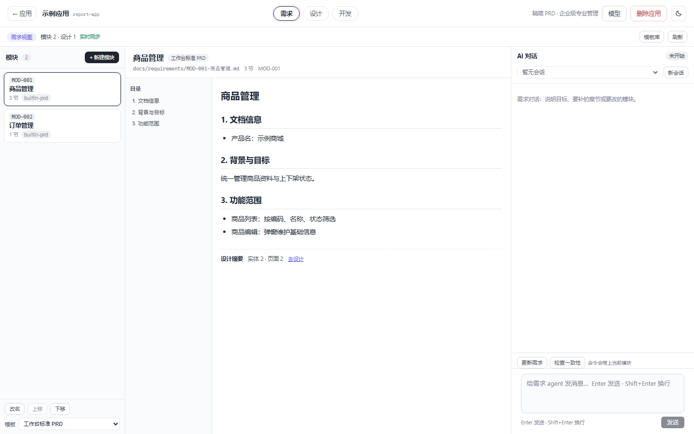
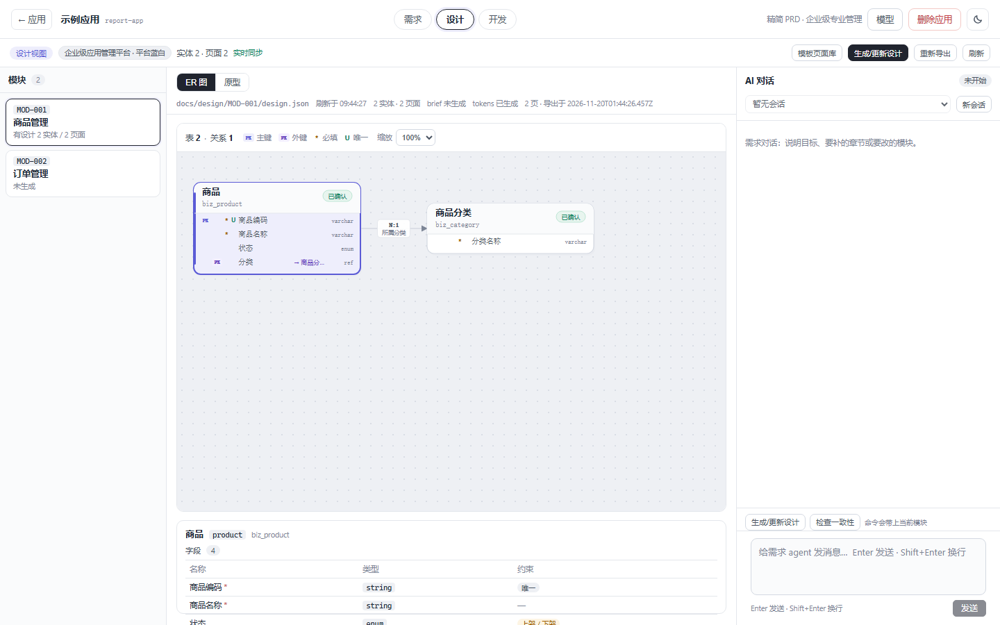
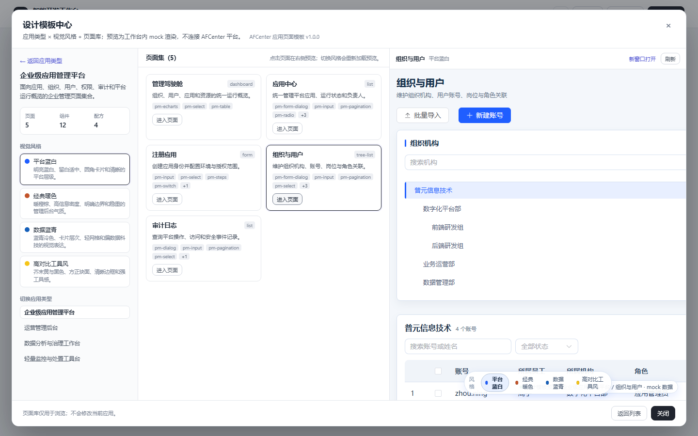
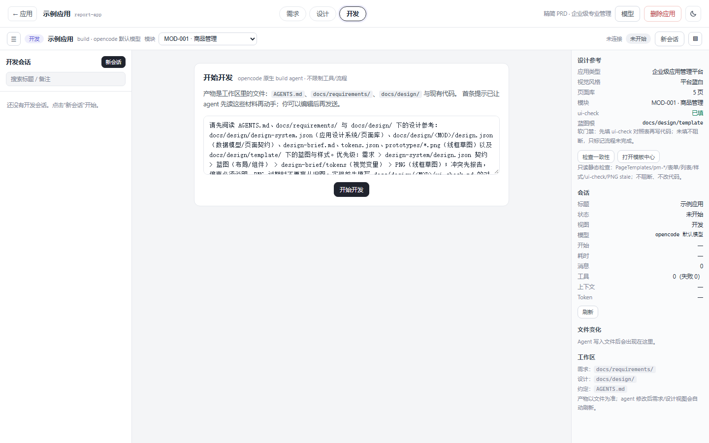
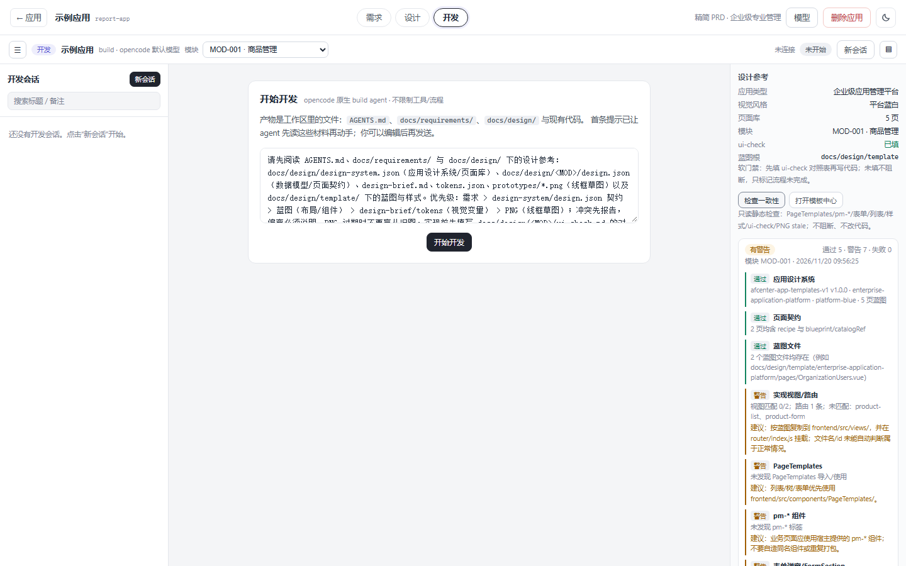

# AI Dev Workbench 概览（Agent-First）

> 版本：2026-11-23（**D3 收尾 + 全量回归**）。P1—P6-4 已评审；P7-1～P7-6c + P7-4b + P8-1 + P8-2 + P9 + P10 + P10b + P11 + P12 + P7-7a/b/c 已实施（待评审）；**D0（去模块 + 三份设计产物 + 接口设计）设计稿已出（待评审），D1（单需求文档 + entities/pages + 去模块底座）、D2（`api-design.md` 固定模板/校验 + 设计视图接口 Tab + 开发引用）、D3（命名清理 + 全量回归 + 文档/汇报）已实施（待评审）**。本文只描述**当前架构**；旧流程（版本、确认、变更单、交接包、U7 阶段、M7-2）已整体移除，见 §9。
> 对应实现：`backend/`（Express + SQLite）、`frontend/`（Vue 3）、`templates/eos-app/`、`templates/afc-remote/`、`templates/design-system/`、`templates/agent/`。
> 真实 3300/4771 当前**有监听**（D3 只读核对：PID **31532** `node dist/index.js`、**45096** `opencode serve`，启动 **2026-11-23 15:08:35/36**；非本轮启停）。D1—D3 前后端均有改动，`backend/dist` **16:48:07**、`frontend/dist` **16:44:58** 已重建；但运行进程（15:08 启动）早于 dist，**仍运行旧后端代码**；前端 dist 已更新但新 UI 依赖新后端 API，**不能只刷新，需用户执行 `restart.cmd`/`restart.sh` 后验收**。库为 4 表新结构，`apps>0` 正常；**当前无 fail-closed**（仅旧 5 表结构 + `apps>0` 才触发）。

## 1. 一页摘要

**痛点**：把“需求 → 设计 → 开发”做成流程引擎后，工作台要维护状态机、确认、版本、变更单与交接包，产物被拆进数据库和协议 JSON；人看不懂，agent 也难用。

**做法**：工作台退化为**共享工作区 + 模板 + 会话 + 产物视图 + 执行过程**。agent 使用 opencode 原生能力（会话、工具、skills、commands、权限），自己检索材料、判断范围、修改文件并检查结果；工作台只做外部管理。

**三个视图**（不是门禁）：

| 视图 | 人看到什么 | 产物 |
| --- | --- | --- |
| 需求 | 单文档、章节大纲/TOC（Epic/Story）、Markdown、对话（占位/思考/中文） | `docs/requirements/requirements.md` |
| 设计 | 设计模板徽标/页面库、全局 ER/页面集、接口设计、设计产物（模板风格；无契约自动结构草图）、导出 PNG、对话 | `entities.json` + `pages.json` + `api-design.md` + `design-brief.md` + `tokens.json` + `prototypes/*.png` |
| 开发 | 会话时间线（工具/终端/diff/权限/表单）、设计参考（接口数/ui-check/蓝图根）、一致性报告（14 项） | 工作区代码（`frontend/` MF remote 等） |

**适用**：需要 AI 参与、但要求“产物可读、可手改、可版本化（由 git 或用户自己管理）”的中小型业务应用。
**不适用**：需要平台化审批、强流程审计、多人并发编辑同一产物的场景（本版明确不做并发/回滚兜底）。

**当前状态**：**D3 收尾（2026-11-23）**：D1/D2 已实施，D3 完成命名清理 + 全量回归 + 文档/汇报；真实模型闭环**未执行（需用户另行授权）**。基线：后端 **235**、前端 **181**；`e2e:p2/p3/p4` **101/129/135**、`e2e:preview/p7-3b/p7-4b/p9/p10` **93/77/57/79/81**、`e2e:p7-6a/p7-7b/p7-7c/api-design` **21/73/118/26**；`smoke:workspace/assets` 通过（opencode 2.2.5，不调模型）。

### 1.1 P7 能力一览

| 能力 | 位置 | 边界 |
| --- | --- | --- |
| 设计模板 pack | 内置 `afcenter-app-templates-v1`：4 应用类型 × 4 风格 × 25 页面 + 蓝图/结构/风格样式 | 内置只读；自定义 pack 预留 `data/design-system/`，本期不做 builder |
| 模板预览 | `preview.html?type=&style=&page=`（同一 Vite 构建第二入口，pm-v3 子集 + mock） | 工作台内 mock，不连接 AFCenter/EOS；pm-sheet 为占位 |
| 设计模板中心 | 首页「设计模板」、新建应用 picker、设计视图徽标/「模板页面库」 | 需求模板中心（「模板库」）保持不变；设计视图原型默认用所选模板原生渲染 `pages.json`（P9/P10） |
| 页面契约 | `pages.json` 页面集（=`epic`）+ 页面 `recipe`、`catalogRef`、`blueprint`、`filters`、`rowActions`、`toolbarActions`、`selection`、`pagination`、`form`、`tree`、`subTables`、`components` | 全部可选；问题只 warning；线框（P7-4b）与模板风格（P9/P10）渲染器都消费契约 |
| 接口设计 | `docs/design/api-design.md` 固定模板（索引/覆盖矩阵/详情/错误码/权限）+ `adw-api-design` skill + `generate-api-design` command + 共享校验 core | 只做 Markdown 文档；不生成后端代码/OpenAPI；errors 阻断、warnings 只报告 |
| 设计 → 开发关联 | 新应用 `frontend/` = MF remote（webpack、Module Federation、PageTemplates、GlobalPreference）；`design-system.json` + `template/` 蓝图/styles；团队 + 设计模板 skill | 生成物尚未 install/build；真实 AFCenter 宿主/EOS 未验证 |
| 开发约束与检查 | 开发 prompt、AGENTS、`adw-frontend-implementation`、digest（应用级）、ui-check 软门禁；fidelity **14 项**（CLI/command/API/开发视图） | 只报告不阻断；PNG 只查 manifest/designHash，无像素比对 |

## 2. 业务流程与数据流



> 同一张图的 PNG（PPT 用）：`assets/flow-overview.png`。

1. 用户在三个视图里描述目标；前端把消息（带当前视图与产物路径提示）交给工作台后端，再转给 opencode 会话。
2. agent 读取 `AGENTS.md`、`docs/requirements/requirements.md`、`docs/design/`（design-system.json、entities.json、pages.json、api-design.md、brief/tokens/prototypes、template 蓝图/ui-check）与现有代码，加载方法 skill、开发方法 skill、团队 skill 和对应模板 skill，按需调用工具修改文件。
3. 工作台不解析聊天协议：直接读取工作区文件（frontmatter + 章节；entities/pages + schema；api-design + 校验 core；design-system.json；brief/tokens/manifest/ui-check），把结构化结果与错误返回给视图渲染。
4. `docs/` 变化由 watcher（300ms 防抖，失败降级 2s 轮询）捕获，通过 SSE `artifacts-changed` 通知前端增量重读；实测外部改文件 ≤1.5s 可见。
5. 全局模板库在 DB；每个被选中的模板生成一个模板 skill（`adw-template-req-<id>` / `adw-template-proto-<id>`），由工作台分发/同步（`_manifest.json` 记录 sourceId + sha256）。
6. 设计模板来自内置 pack：应用创建时解析「类型 × 风格」，写 `app_settings` 三键；前端 `preview.html` 与模板中心提供页面库/风格预览。
7. 新建应用时工作台生成独立 MF remote，复制选中类型的蓝图/structure/assets 与 `styles/<styleId>/style.css`，写 `docs/design/design-system.json`，分发团队 skill 与设计模板 skill。
8. 开发 prompt 注入应用级 design digest，要求先填 `docs/design/ui-check.md` 再写代码；完成后可用 CLI/接口/开发视图跑一致性检查（只读报告，14 项）。
9. 设计视图在 entities/pages/design-system hash 变化时自动导出原型 PNG：有显式契约的页面在 `design-preview` iframe 内用真实模板渲染并 html2canvas 自截，无契约旧设计/失败回退隐藏线框画布 → `POST /api/apps/:id/design/prototypes` → 写 `prototypes/*.png` + manifest + `tokens.json`；PNG 是模板风格截图（无显式契约的旧设计为线框），视觉以蓝图 + 预览为准。

## 3. 工作区与文件契约

```text
projects/<app>/
├─ AGENTS.md                 应用级约定（布局/技术栈/中文/设计系统与开发规则/接口设计/ui-check/一致性/汇报）
├─ README.md · opencode.json permission.edit：* allow；.opencode/skills|commands deny
├─ .opencode/
│  ├─ skills/
│  │  ├─ adw-requirements-document/ · adw-design-artifacts/ · adw-api-design/  3 个方法 skill
│  │  ├─ adw-frontend-implementation/                        开发方法 skill（含 check-fidelity.mjs）
│  │  ├─ afcenter-page-generation/ · pm-components-usage/    团队 skill（原样复制）
│  │  ├─ adw-template-req-<id>/                              需求模板 skill
│  │  └─ adw-template-proto-<applicationType>/               设计模板 skill（pack 型）
│  └─ commands/  update-requirements · generate-design · generate-api-design · preview-app · check-consistency · check-design-fidelity
├─ docs/
│  ├─ requirements/requirements.md   单文档（frontmatter 只 title/template；Epic/Story 稳定 ID）
│  └─ design/
│     ├─ entities.json         全局实体/关系（字段 code/name/type）
│     ├─ pages.json            页面集 = Epic + 页面契约
│     ├─ api-design.md         接口设计（固定模板：索引/覆盖矩阵/详情/错误码/权限）
│     ├─ design-system.json    pack/类型/风格/风格路径/页面库/蓝图根/团队 skill
│     ├─ template/<type>/      pages/*.vue · contracts/*.json · structure.css · assets/
│     ├─ template/styles/      shared.css + <styleId>/style.css
│     ├─ design-brief.md · tokens.json   设计说明（自由文本）/ 视觉变量（工作台写入）
│     ├─ ui-check.md           开发前后对照表 + 接口对照（软门禁，应用级）
│     └─ prototypes/           _manifest.json + <page-id>.png（模板风格截图；无显式契约旧设计为线框）
├─ frontend/                  AFCenter MF remote（webpack + Module Federation，暴露 ./index）
│  ├─ src/components/PageTemplates/ · src/preferences/GlobalPreference.js
│  └─ src/views/ · src/router/ （开发实现）
└─ backend/                   EOS 9.0.0 后端骨架
```

### 3.1 需求单文档

```markdown
---
title: 商品管理
template: builtin-prd
---

# 商品管理

## 1. 文档信息
### EP-001 商品管理
#### US-001 商品台账
```

- 需求 = `docs/requirements/requirements.md` 一份文档；Epic `EP-001`、Story `US-001` 为稳定 ID，不拆模块文件/目录。
- 新建应用按需求模板纯渲染骨架（不调模型、已存在不覆盖）；需求视图只做单文档 + TOC（Epic/Story 定位）+ AI。
- 需求 `template` 对应 `adw-template-req-<id>` skill；找不到时用应用默认模板 skill，再找不到按方法 skill 通用要求写并说明。

### 3.2 设计文件与页面契约

```jsonc
// entities.json
{ "schemaVersion": 2, "entities": [{ "id": "product", "name": "商品",
  "fields": [{ "code": "productCode", "name": "商品编码", "type": "string" }] }], "relations": [] }
// pages.json
{ "schemaVersion": 2, "pageSets": [{ "id": "product", "epic": "EP-001", "title": "商品管理",
  "primaryEntity": "product", "pages": [{ "id": "product-list", "name": "商品列表", "type": "list",
    "entity": "product", "recipe": "list", "columns": ["productCode"], "filters": ["status"],
    "rowActions": ["detail", "edit"], "toolbarActions": ["create"],
    "selection": true, "pagination": { "layout": "three-part", "pageSize": 20 } }] }] }
```

| 契约字段 | 说明 |
| --- | --- |
| `recipe` | list / tree-list / dialog-form / page-form / main-sub / detail / dashboard / wizard |
| `catalogRef` / `blueprint` | 模板页面库引用 `<type>/<pageId>` / 蓝图 Vue 路径 |
| `filters` / `rowActions` / `toolbarActions` / `selection` / `pagination` | 查询、行操作、工具栏、多选、分页 |
| `form` / `tree` / `subTables` / `components` | 表单形态与字段、树字段与样式、子表、字段→pm 组件覆盖 |

- 格式唯一来源：`adw-design-artifacts/references/entities.schema.json` 与 `pages.schema.json`（后端解析与 `validate.mjs` 共用）；全部可选；字段引用一律用 `code`，新字段/动作枚举问题只产生 warning（保留原值、不阻断）。
- 解析错误作为产物的一部分返回（文件/字段/期望），UI 错误条 +「让 AI 修」；`entities.json`/`pages.json`/`design-system.json` 的 sha256 组成 `designHash`，PNG/manifest 用它判断过期。
- **渲染器消费（P7-4b）**：`tree-list`/`tree` → 左树右表（`titleField/parentField`、`selectionStyle`、`actionStyle`）；`selection` → 勾选列 + 批量条；`rowActions/toolbarActions` 按动作码渲染；`pagination` bar|split|three-part；`form.presentation=dialog` → 弹窗（`width` clamp、`columns`、`groups`）；`components` 的 `pm-*` 映射控件；`subTables` 多个且 `mode=tab` → 页签。
- **接口设计（D2）**：`api-design.md` 索引/详情含 `操作`（list/detail/create/update/delete/batchDelete/export/import/action/other）；覆盖矩阵校验页面动作（`rowActions/toolbarActions`，form 补 `submit`）与实体 CRUD；设计视图「接口设计」Tab 可渲染/校验/让 AI 修。
- **状态**：`designHash` 变化触发 PNG 过期判断。

### 3.3 设计参考包（P6-3）

- **结构**：`entities.json` + `pages.json` 是唯一结构来源；`design-brief.md` 由设计 agent 维护（概览/导航/页面/组件/风格），不校验格式。
- **风格**：`tokens.json` 由工作台按应用设计系统的视觉风格写入（`{styleId, name, tokens}`，P8-1 起不再有 `templateId`/`shell`）；`prototypes/*.png` 由设计视图导出：有显式契约的页面在 `design-preview` iframe 内用真实模板 + html2canvas 自截，无契约旧设计/失败回退隐藏线框画布（P10/P10b）；manifest 记录 `designHash/styleId/exportedAt/pages`。
- **过期**：manifest hash 与当前设计产物不一致 → 设计视图黄条「原型图已过期」+ 重新导出；开发 prompt 要求“结构以 entities/pages 为准，PNG 过期先说明”。
- **权限/边界**：PNG 只接受 `data:image/png;base64`，校验 hash/魔数/大小/page id/pageSet；tokens/PNG 只约束 Vue3 前端，EOS 后端不吃风格。

### 3.4 设计模板与蓝图（P7）

- 内置 pack：4 应用类型（企业级应用管理平台、运营管理后台、数据分析与治理工作台、轻量监控与处置工具台）× 4 风格（平台蓝白、经典暖色、数据蓝青、高对比工具风）× 25 页面；页面带 recipe/catalogRef/blueprint/组件清单。
- 新建应用把选中类型的 `pages/*.vue`、`structure.css`、`assets/` 复制到 `docs/design/template/<type>/`，把 `shared.css` 与 `styles/<styleId>/style.css` 复制到 `docs/design/template/styles/`；`design-system.json` 记录 `pack/applicationType/style/styleId/blueprintRoot/templateDir/pages[]/skills`。
- 设计/开发读取顺序：`design-system.json` → 选中类型页面库/蓝图 → `entities.json`/`pages.json` 契约 → `api-design.md` → brief/tokens → PNG（模板风格截图；无显式契约旧设计为线框）。蓝图 + 预览是视觉事实；PNG 是模板视觉的截图参考（过期先说明）。
- 设计模板是**唯一设计入口**（P8-1）：旧原型模板已删除，设计视图皮肤由所选风格 tokens 构造。
- 边界：生成物 `frontend/` 未 install/build；真实 AFCenter 宿主 `pm-*` 运行态未验证；已有应用改设计模板不补建 `frontend/`。

### 3.5 开发关联与 ui-check（P7-5）

- 新应用前端 = 独立 MF remote：`webpack + Module Federation` 暴露 `./index`，含 `PageTemplates`（List/TreeList/TreePanel/Form/…/ThreePartPagination）与 `GlobalPreference`，不含 demo 业务页。
- 开发提示优先级：**需求 > pages.json 结构/字段/交互 > entities.json / api-design.md > 蓝图（布局/组件） > brief/tokens（视觉变量） > PNG（模板风格截图；无显式契约的旧设计为线框）**；冲突先报告，偏离要说明。
- 首次开发会话按应用生成 `docs/design/ui-check.md` 骨架（实现前/实现后/接口对照/未实现项），已存在不覆盖；状态只读显示“未生成/已生成未填/已填”，不阻断。
- 一致性检查 **14 项**：设计系统、页面契约、蓝图文件、实现视图/路由（启发式）、PageTemplates、pm-*、表单弹窗、`v-auto-height`、GlobalPreference、结构/风格导入、模板契约页、ui-check、PNG stale、接口设计；CLI、后端接口与开发视图共用同一规则。

## 4. 扩展能力（skills / commands / 权限）

| 能力 | 内容 | 设计要点 |
| --- | --- | --- |
| 方法 skill `adw-requirements-document` | 需求写作方法：调查工作区、按模板写目标/验收、需求↔设计同步、交付前回读 | 方法而非步骤；不绑定某一份模板 |
| 方法 skill `adw-design-artifacts` | 设计产物方法：读需求/设计系统/schema、实体与页面契约、`validate.mjs`、维护 brief | schema 是唯一格式源；tokens/PNG 受管 |
| 方法 skill `adw-api-design` | 接口设计方法：固定模板/规范/示例、覆盖矩阵、`validate-api-design.mjs`、索引/详情/错误码/权限 | 只做 Markdown 文档；不生成后端代码/OpenAPI |
| 开发方法 skill `adw-frontend-implementation` | 读取顺序、蓝图复制/适配、PageTemplates/pm-*、ui-check、截图比对、冲突上报、`check-fidelity.mjs` | 只约束 Vue3 前端；EOS 后端不吃风格 |
| 团队 skill `afcenter-page-generation` / `pm-components-usage` | 原样复制的团队页面生成与 pm 组件用法（assets/references/scripts） | 与蓝图/预览同一套组件口径 |
| 模板 skill `adw-template-req-<id>` / `adw-template-proto-<applicationType>` | 需求模板章节骨架；设计模板的 pack/类型/风格/页面库/蓝图/配方/边界 | 只生成被选中的模板；manifest 白名单清理 |
| 6 个 command | `update-requirements`、`generate-design`、`generate-api-design`、`preview-app`、`check-consistency`、`check-design-fidelity` | UI 按钮与 TUI 共用同一文件；检查类只报告 |
| 权限 | 应用 `opencode.json` 对 `.opencode/skills|commands/**` 设 `edit: deny` | 防止 agent 改受管资源 |

- **模板即 skill**：全局保存 → 重新生成对应 skill 并同步引用应用；应用创建/打开/会话启动幂等对齐；删除模板按引用检查后移除 skill；清理只按 manifest 白名单，不碰团队/用户 skill。
- **为什么不用版本/确认/交接包**：产物是文件，版本与差异交给 git；确认是人的判断；交接包本质是“把文件再抄一遍”，会立刻漂移。工作台只在文件变化时通知视图刷新。

## 5. 数据与接口

### 5.1 数据表（4 张）

| 表 | 用途 |
| --- | --- |
| `apps` | 应用登记 + 默认需求模板 id + 当前视图标签（无门禁语义） |
| `app_settings` | 应用设置；设计系统存 `app.<id>.design.pack/applicationType/style` 三键 |
| `app_sessions` | 会话登记（按 `view`：requirements / design / development） |
| `requirement_templates` | 全局需求模板库（内置 4 个） |

启动升级：新结构 no-op；旧结构 + `apps` 为空 → 重建为 **4 表**（保留需求模板库，删除旧原型模板表/列）；旧结构 + 有应用数据 → **fail-closed**（不迁移、不删数据）。设计模板 pack 只从文件读取，不入库。

### 5.2 主要接口

| 分组 | 接口 |
| --- | --- |
| 应用 | `GET/POST /api/apps`、`GET/DELETE /api/apps/:id`、`PATCH /api/apps/:id/status`、`GET /api/apps/:id/templates` |
| 设计系统 | `GET /api/design-system`、`GET /api/design-system/:packId`、`GET/PATCH /api/apps/:id/design-system` |
| 产物 | `GET /api/apps/:id/artifacts`、`GET /api/apps/:id/events`（SSE）、`POST /api/apps/:id/design/prototypes` |
| 需求文档 | `GET/POST /api/apps/:id/requirements-document`（单文档；缺失生成骨架、不覆盖） |
| 开发关联 | `POST /api/apps/:id/design-fidelity`（只读一致性报告；应用级 14 项） |
| 对话 | `POST /api/apps/:id/chat`（SSE）、`POST /api/apps/:id/compact`、`GET/PUT /api/apps/:id/model` |
| 会话 | `/api/apps/:id/development/*`：state / sessions / activate / prompt / interrupt / compact / events / permission / form |
| 模板库 | `/api/requirement-templates`、`POST /api/templates/requirement/:id/sync`、`GET .../usage` |
| 运行时 | `/api/opencode/*`：health/start/stop/models/agents/skills/commands/sessions/events；`GET /preview.html`（模板中心预览）、`GET /design-preview.html`（设计产物模板风格渲染）静态入口（缺失 404、不回落 index） |

## 6. 视图与开发体验

### 6.1 会话模型与聊天体验

- **每个视图一个活跃会话 + 历史**：需求/设计用轻量下拉（最近 5 个 + 新建），开发保留完整会话列表（搜索/重命名/归档/恢复/只读）。
- **上下文健康度**按模型 `limit.context` 计算（60% 黄 / 85% 红）；85% 给非阻塞横幅：压缩后继续（opencode compact）或开新会话（衔接文案填入输入框，不自动发送）。
- **聊天占位**：发送先显示“思考中…”，首个 delta/assistant 消息替换；失败/中断必须替换为失败/“已中止”。
- **reasoning**：assistant `reasoning` 以“思考”折叠块渲染；需求/设计默认折叠，开发展开。
- **中文指令**：`CHINESE_INSTRUCTION` 注入三个视图、6 个 command、应用 AGENTS；代码/命令/路径允许英文。
- **SSE 收尾（P7-6c）**：最后事件后 10s 用会话/消息确认 idle 后补 `done`，20 分钟总超时；开发视图按末条 idle/outcome 收敛“运行中”；断线/中断不重复写 done。

### 6.2 时间线与执行过程

- 开发视图归一化 opencode 消息：文本、思考、工具卡（输入/输出/diff/终端）、权限卡、表单卡、压缩系统提示、失败原因；工具/命令卡片默认折叠。
- SSE 实时事件 + 350ms 节流刷新；`session.execution.*`/`idle` 立即刷新；时间线只显示用户原文（后端 `displayUserText` 归一化）。

### 6.3 变化检测、设计导出与错误

- 只监听 `docs/`；watcher 300ms 防抖 → SSE `artifacts-changed {paths, hashes}` → 视图增量重读。
- 设计视图打开且 entities/pages/design-system hash 变化 → 1s 防抖自动导出全部页面 PNG（有显式契约的页面走模板风格截图，无契约/失败回退线框）；手动「重新导出」与面板「导出 PNG」兜底且都是整包导出；失败保留旧图并提示。
- 格式错误不白屏：错误条列出“文件 · 字段 · 期望”，可一键把摘要填进对话（不自动发送）。

### 6.4 设计模板中心与预览（P7）

- 首页「设计模板」入口：4 应用类型卡片（页面数/组件数/CSS 缩略图）+ 分类 tabs（含「自定义」）+ 搜索；详情左侧类型/风格、中部页面集、右侧 iframe 预览；切换风格/页面只改 `preview.html?type=&style=&page=` 的 iframe URL（根节点 `visual-style-*` 类，不重建页面），失败提示 + 重试。
- 新建应用「设计模板」picker 与设计视图徽标/「模板页面库」共用同一中心；需求模板中心「模板库」保持 P6 行为不变；自定义模板走模板工作室（P7-7）。

### 6.5 开发视图设计参考与一致性检查（P7）

- 顶部设计模板徽标/「模板页面库」；左侧页面集/实体；右侧「设计参考」显示应用类型/风格/页面库/接口数/ui-check 状态/蓝图根 +「检查一致性」「打开模板中心」。
- 检查报告：总体状态、通过/警告/失败计数、时间、逐项证据与建议（14 项）；只读，不自动改代码、不影响会话/时间线。

### 6.6 示例界面











> 截图来自临时 stub 实例（临时目录 + 独立端口，stub opencode）的示例数据，不含真实项目数据，也不代表真实模型/宿主验收结果。设计视图深色版见 `assets/view-design-dark.png`。
>
> **截图状态（D3）**：`assets/view-*.png` 仍是 2026-11-20 及以前的截图，部分仍显示模块下拉/旧 13 项；**本轮未重截报告截图**（报告只更新文字口径）。当前 UI 证据见 `docs/plans/evidence/2026-11-23-ui2a/`、`ui2b/`、`ui3a/`、`ui3b/`（D3 已用 stub 实例重跑，含 1440/1024/390）。

**设计产物模板原生渲染（P9/P10/P10b/P11，Y2）**：设计视图「原型」Tab 用**创建应用时选择的设计模板**（应用类型 structure + 视觉风格）**原生渲染 `pages.json` 该页**（`design-preview.html?app=&page=&type=&style=&embed=1&v=<designHash>`，同源读 `artifacts` → `adaptDesign`）：根 `visual-style-<style>` + `optimized-suite application-type-<type>`，注入 `structure.css`/`shared.css`/`style.css`；用模板结构类（`template-stage`/`business-page`/`page-heading`/`panel`/`org-ledger-shell`/`org-tree-panel`）与 `pm-search`/`pm-toolbar`/`pm-table`/`pm-pagination`/`pm-tree`/`pm-form-dialog`/`pm-echarts`/`pm-steps`/`pm-*` 渲染契约的列/查询/操作/选择/分页/树/表单分组，数据为确定性本地 mock，缺失列/字段跳过并提示。P10 扩展到 **list / tree-list / page-form / dialog-form / detail / dashboard**（dashboard = 指标卡 + `pm-echarts` + 最近记录；detail = 主信息 + 字段 + 状态 + 时间线 + 子表）；P10b 让**所有显式契约页面**都模板化：**main-sub**（表单分组 + 子表页签 `pm-table`）、**wizard**（`pm-steps` + 当前分组 + 上一步/下一步/提交），未知/无映射配方按 `page.type` 映射到通用模板页。P11 起**设计视图只展示设计产物，不再提供「模板风格/线框」切换**：无任何显式契约的旧设计自动显示「结构草图（无契约）」并提示补齐契约；结构草图仅无契约兜底或调试 `?prototype=wireframe` 出现。**PNG 仍是模板风格真实截图**（`capture=1` + iframe 内 html2canvas，自动/手动整包导出，无契约/失败回退线框）。模板中心仍用 `preview.html`（不变）。

## 7. 演示脚本

**3 分钟（给管理者）**

1. 首页「设计模板」→ 展示 4 类应用模板、风格切换、页面 iframe 预览；新建应用选「企业级 · 平台蓝白」。
2. 需求视图单文档白板 → 点「生成文档骨架」；让对话补全「目标与验收」，看占位 → 思考 → 流式中文回复。
3. 设计视图生成全局 ER/页面集与接口设计（自动导出 PNG），开发视图展示设计参考（接口数/ui-check/蓝图根）与「检查一致性」报告。

**10 分钟（给工程团队）**

1. 展示工作区：`AGENTS.md`、3 个方法 skill、2 个团队 skill、6 个 command、design-system.json + template 蓝图、entities/pages/api-design + brief/tokens/prototypes + ui-check。
2. 改单文档正文或 `template` → ≤1.5s 刷新；非法 entities/pages/api-design → 错误条 +「让 AI 修」；新契约字段只 warning；新建应用 `frontend/` = MF remote + PageTemplates + GlobalPreference。
3. 开发对话要求“先读 design-system/entities/pages/api-design/蓝图，填 ui-check，再实现页面”→ 工具卡/diff/文件变化；点「检查一致性」看 **14 项**只读报告（不阻断、不做像素比对）。

## 8. 边界与未验证

- **不做**：版本/确认/变更单/交接包/覆盖度/门禁；文件丢失/回滚/并发/多实例兜底；git 操作；MCP/插件/自定义 tool；接口文档不生成后端代码/OpenAPI；fidelity 不做像素级比对。
- **P7-4b 边界**：渲染器只消费契约做线框演示（树节点不改变表格数据、弹窗不提交、分页不真实翻页）；`e2e:p3` **129** 保持。
- **生成物未验证**：`frontend/` 的 `npm install` / `dev` / `build:prod`、页面真实渲染与截图比对均未执行。
- **宿主/平台**：真实 AFCenter 宿主 `pm-*`、`v-auto-height` 实际效果、EOS 后端构建/运行态、真实 401/403 未验证；内部 Maven 仓库/Nacos/MySQL/Redis 是外部前提。
- **视觉/PNG**：PNG 来自前端 html2canvas（P10 起在 `design-preview` iframe 内按所选模板自截；无显式契约旧设计/失败回退线框），依赖设计视图打开时自动导出；未打开不会后台生成；fidelity 只查 manifest/designHash，**无像素级比对**；PNG 是模板风格截图，`e2e:p10` 只做宽高 + 主色像素采样。
- **模型相关**：真实模型可能“回复已完成但内容未落地”；skill 要求改后回读；`reasoning` 语言由模型决定，中文指令不保证 100%。**D3 未执行真实模型闭环（需用户另行授权）**。
- **报告截图**：`docs/report/assets/view-*.png` 未重截（部分仍显示旧模块/13 项）；当前 UI 证据见 `docs/plans/evidence/2026-11-23-ui2a|ui2b|ui3a|ui3b/`。
- **P7/P9/P10/P10b/P11 已知小问题**：`pm-sheet` 预览为占位；模板中心 iframe 内保留预览自带风格切换器（与中心顶部重复）；部分既有软字段在后端 artifacts 仍按 errors 返回（不阻断）。P11 起 UI 不再有线框切换，无显式契约旧设计自动结构草图、调试用 `?prototype=wireframe`；交互为展示级 mock，PNG 为模板风格截图；html2canvas 不支持的 `color(srgb …)` 在克隆时降级，只影响截图。
- **真实 3300**：D3 只读核对 3300/4771 有监听（PID **31532** `node dist/index.js` / **45096** `opencode serve`，启动 **2026-11-23 15:08:35/36**；**非本轮启停**）；D1—D3 前后端均有改动，`backend/dist` **16:48:07** / `frontend/dist` **16:44:58** 已重建，但运行进程（15:08 启动）早于 dist，**仍运行旧后端代码**；前端 dist 已更新但新 UI 依赖新后端 API，**不能只刷新，需用户 restart 后验收**。库为 4 表新结构，`apps>0` 正常；**当前无 fail-closed**（仅旧 5 表结构 + `apps>0` 触发）。`start` 每次构建前后端，`restart.cmd` / `restart.sh` = stop → build → start → 健康检查；后续重启/切换由用户按 `docs/ops/switch-to-agent-first.md` 执行。
- **安全**：serve 密码只存内存；日志/接口统一脱敏；应用创建表单里的 EOS/DB/邮件凭据只写入 `projects/<app>/`，不写入工作台数据库。

## 9. 与旧版关系

旧版把需求/设计/开发做成流程与交接包（版本、确认、Change Set、`00—05` 交接文档、U7 阶段、M7-2 原型规格）。这些能力与代码、测试、前端组件已在 P1 一次性移除；本版**没有**重新引入，也不打算以“弱化版”恢复。需要历史资料时从 GitHub 仓库历史查看。

## 10. 仓库与验证基线

| 项 | 当前 |
| --- | --- |
| 后端单测 | **235**（含 db/opencode/apps/chat/dev/design/workspace/templates；D2 新增 `dev/api-design.test.ts`） |
| 前端单测 | **181**（含 preview-params、design-template、adapter/export、contract-view、design-preview/contract-preview、design-ref、api-design helpers） |
| 冒烟 | `smoke:workspace`、`smoke:assets`（真实 opencode 2.2.5，不调模型；3 方法 + 1 开发 + 2 团队 + 设计模板 + 需求模板 skill + 6 command）、`smoke:dev` |
| Playwright（stub） | `e2e:p2/p3/p4` **101/129/135**、`e2e:preview` **93**、`e2e:p7-3b` **77**、`e2e:p7-4b` **57**、`e2e:p9` **79**、`e2e:p10` **81**、`e2e:p7-6a` **21**、`e2e:p7-7b` **73**、`e2e:p7-7c` **118**、`e2e:api-design` **26**；浅/深 × 1440/1024/390 |
| 静态 | `npm run build --prefix backend`、`npm run typecheck --prefix frontend`、`npm run build --prefix frontend`、`npm run check:vue --prefix frontend` |
| 真实模型证据 | 首跑 2026-11-19：设计 90,474ms；开发 265,196ms 被外部会话 interrupt（产物完整）；fidelity 11/1/0。复跑 2026-11-20：设计 93,327ms、开发 234,491ms、done=true、无 error、ui-check filled、fidelity 11/1/0。P7-7c-2（2026-11-21）真实模板工作室闭环 fidelity 0 fail。证据：`docs/plans/evidence/2026-11-19-p7-6b/`、`2026-11-20-p7-6b-rerun/`、`2026-11-21-p7-7-real-model/`、`2026-11-23-dev-view-real-model/`；D3 未跑真实模型 |
| 运行 | Node 20.20.1 / npm 10.8.2 / opencode 2.2.5；工作台默认 3300，opencode serve 默认 4771（仅回环） |
| 启动/重启（P12） | `start.cmd` / `start.sh` **每次启动都构建前后端**（后端 tsc、前端 vite 两步，失败指明哪端）；`restart.cmd` / `restart.sh` = stop → 构建 → start → 健康检查；已在运行时 `start` 提示改用 `restart` |

**术语**：pack=设计模板包（应用类型/风格/页面蓝图）；preview=工作台内模板页面预览；契约=`pages.json` 页面字段（recipe/columns/actions/form/tree…）；MF remote=Module Federation 子应用；ui-check=开发前后页面对照表（软门禁）；fidelity=设计一致性静态检查（只读报告，14 项）。

启动/安装见仓库 `README.md`；真实实例切换见 `docs/ops/switch-to-agent-first.md`。
