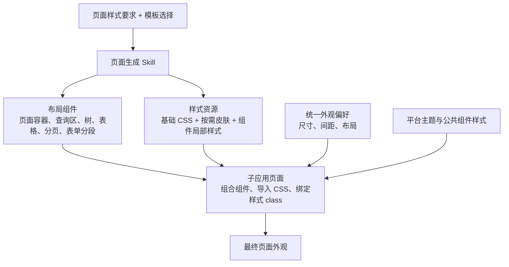

# 页面样式生成架构

根据页面样式要求选择模板，由 Skill 组合布局组件、安装所选样式，在子应用中生成页面外观。

- **布局组件**：决定页面各区域的排列与结构。
- **样式资源**：决定表格、工具栏、查询区和表单分段的视觉效果，可选皮肤按需安装。
- **统一外观偏好**：通过项目 GlobalPreference 提供尺寸、间距和布局等有效配置。
- **平台主题**：提供公共组件的基础外观，模板样式按需局部覆盖。
<!-- Modified by AI on 2026-11-13 10:24:41 -->
